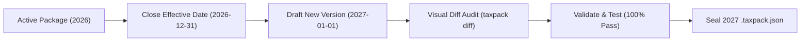

# Authoring & Rollover Guide: Adding States and New Tax Years

This guide provides step-by-step instructions for adding tax rules for a new jurisdiction (state/locality) or rolling over tax rules to a new tax year in the `@taxshield/tax-rule-packaging-engine`.

Governed by the core principle: **"Tax law is data, not application code."**

---

## Non-Negotiable Invariants

Before writing or modifying any rule, ensure your contribution satisfies all 4 invariants:

1. **Mandatory Tier-1 Citations**: Every package must reference at least one `TIER_1_OFFICIAL` government authority (statute citation, government agency URL, official publication date, and SHA-256 document hash).
2. **Mandatory Regression Tests**: Every rule version must include at least one golden test case (`inputPayload` $\to$ `expectedOutput`). Packages cannot be sealed without 100% test pass rates.
3. **Monotonic & Contiguous Brackets**: Progressive bracket tiers must not overlap or leave gaps. Bracket $n$'s `incomeTo` must exactly match bracket $n+1$'s `incomeFrom`.
4. **Normalized Decimal Rates**: Percentages must be expressed as decimals ($3.07\% \to 0.0307$). To prevent JS floating-point artifacts, sanitize rates with `Number((percent / 100).toFixed(6))`.

---

## Scenario A: Adding a New State

Follow these steps when onboarding a new state (e.g. New Jersey, California, Ohio):

### Step 1: Collect Statutory Source Documents

Identify the official governing authorities for personal income tax (DOR/Treasury) and unemployment tax (DOL/Workforce Commission).

| Requirement | Example: State Personal Income Tax | Example: State Unemployment (SUTA) |
| :--- | :--- | :--- |
| **Authority** | State Department of Revenue | State Department of Labor |
| **Statute** | e.g. `N.J.S.A. § 54A:1-1` | e.g. `N.J.S.A. § 43:21-7` |
| **Official URL** | `.gov` publication or bulletin URL | `.gov` employer contribution schedule |
| **Tax Structure** | Flat rate, progressive brackets, or zero-tax | Taxable wage base + entry/experience rate |

---

### Step 2: Choose Your Authoring Method

#### Option 1: Automated Authority Adapter (Recommended)

Create a dedicated adapter to automatically fetch and compile the state's rules from government notices:

1. Create [`src/ingestion/adapters/<state>Adapter.ts`](file:///c:/dev/TaxLedger/tax-rule-packaging-engine/src/ingestion/adapters/txAdapter.ts) implementing `IAuthorityAdapter`.
2. Implement `fetchSourceDocuments(taxYear)` returning official notices with calculated SHA-256 hashes.
3. Implement `parseTaxRules(documents, taxYear)` to extract:
   - **Flat Rate**: `ruleType: "FLAT_RATE"`, `rate: 0.0307`
   - **Progressive Brackets**: `ruleType: "BRACKET_PERCENTAGE"`, `brackets: [...]`
   - **Zero Personal Tax**: `ruleType: "FLAT_RATE"`, `rate: 0.0` (with constitutional citation)
   - **SUTA**: `ruleType: "FLAT_RATE"`, `wageCap: 10500`, `rate: 0.023`
4. Register your adapter in [`src/ingestion/ingestionPipeline.ts`](file:///c:/dev/TaxLedger/tax-rule-packaging-engine/src/ingestion/ingestionPipeline.ts).
5. Run the CLI ingestion command:
   ```bash
   pnpm cli ingest <STATE_CODE> 2026 ./draft-<state>.json
   ```

#### Option 2: Direct Draft JSON Authoring

Alternatively, author a JSON file adhering to `IDraftTaxRulePackage`:

```json
{
  "packageCode": "NJ-STATE-2026",
  "name": "New Jersey State Tax Rules 2026",
  "version": "1.0.0",
  "jurisdictionCode": "NJ",
  "jurisdictions": [
    { "code": "NJ", "name": "New Jersey", "level": "STATE" }
  ],
  "rules": [
    {
      "ruleCode": "NJ_SIT_RATE",
      "name": "New Jersey Gross Income Tax",
      "category": "WITHHOLDING",
      "taxType": "STATE_INCOME_TAX",
      "jurisdictionCode": "NJ",
      "versions": [
        {
          "versionCode": "NJ_SIT_2026_V1",
          "versionNumber": 1,
          "status": "APPROVED",
          "ruleType": "FLAT_RATE",
          "ruleData": { "rate": 0.014 },
          "effectiveFrom": "2026-01-01T00:00:00.000Z",
          "effectiveTo": null,
          "citations": [
            {
              "authority": "NJ_DIV_OF_TAXATION",
              "title": "NJ Gross Income Tax Withholding Instructions",
              "statuteReference": "N.J.S.A. § 54A:1-1",
              "sourceUrl": "https://www.state.nj.us/treasury/taxation/",
              "publicationDate": "2025-12-15",
              "citationTier": "TIER_1_OFFICIAL"
            }
          ],
          "testCases": [
            {
              "id": "tc_nj_001",
              "description": "Standard wage withholding test",
              "inputPayload": { "grossWages": 1000.0 },
              "expectedOutput": { "withholding": 14.0 }
            }
          ]
        }
      ]
    }
  ]
}
```

---

### Step 3: Validate the Draft Package

Run the multi-tier validation pipeline against the draft:

```bash
pnpm cli validate ./draft-<state>.json
```

The pipeline verifies:
- Schema conformance via Zod.
- Date boundary safety (no internal overlapping date ranges).
- Boundary sanity ($0 \le \text{rate} \le 1.0$, wage caps $> 0$).
- Tier-1 citation presence.

---

### Step 4: Run the Regression Test Suite

Evaluate the bundled golden test cases:

```bash
pnpm cli test ./draft-<state>.json
```

> [!IMPORTANT]
> The engine strictly forbids package publication if any regression test fails (`passCount === totalTests` required).

---

### Step 5: Cryptographically Seal the Package

Build the immutable, canonical `.taxpack.json` package with sorted keys and SHA-256 digest:

```bash
pnpm cli build ./draft-<state>.json ./packages/<STATE>-STATE-2026.taxpack.json
```

The resulting file is ready for downstream consumption by `shared-core`.

---

## Scenario B: Annual Tax Year Rollover (e.g. 2026 $\to$ 2027)

When federal or state authorities issue changes for a new tax year, follow this rollover procedure:



### Step 1: Cap the Existing Active Version

In the previous year's package or database model:
- Update `effectiveTo` of the active version from `null` to `"2026-12-31T23:59:59.999Z"`.
- Never delete or overwrite historical records.

### Step 2: Create the 2027 Version

In the new draft package:
1. Increment `versionNumber` to `2`.
2. Set `versionCode` to e.g. `<RULE>_2027_V1`.
3. Set `effectiveFrom` to `"2027-01-01T00:00:00.000Z"`.
4. Set `effectiveTo` to `null`.
5. Update adjusted parameters:
   - Federal Social Security wage cap adjustments.
   - SUTA taxable wage base adjustments.
   - State tax bracket cost-of-living adjustments.
6. Update citations with the new tax year's government bulletin/statute.
7. Update test cases to verify both pre-cap and post-cap thresholds for 2027.

---

### Step 3: Run Visual Diffing

Compare the base year against the new draft to review all parameter deltas:

```bash
pnpm cli diff ./packages/US-FED-2026.taxpack.json ./draft-fed-2027.json
```

The diff engine reports exact deltas:
```text
Diff between FED_FICA_SS_2026_V1 and FED_FICA_SS_2027_V1:
- hasDifferences: true
- deltas:
  * ruleData.wageCap: 176100 -> 181800
  * effectiveFrom: 2026-01-01 -> 2027-01-01
```

---

### Step 4: Validate, Test, and Seal

Execute the standard release gate:

```bash
# 1. Validate rules, citations, and dates
pnpm cli validate ./draft-fed-2027.json

# 2. Run regression suite
pnpm cli test ./draft-fed-2027.json

# 3. Seal into production package
pnpm cli build ./draft-fed-2027.json ./packages/US-FED-2027.taxpack.json
```

---

## Troubleshooting & Checklist

| Issue | Root Cause | Resolution |
| :--- | :--- | :--- |
| **`INVALID_CITATION_TIER`** | Citation is marked `TIER_2` or `TIER_3` | Add at least 1 authoritative `TIER_1_OFFICIAL` government publication. |
| **`NON_MONOTONIC_BRACKETS`** | Bracket $n$ `incomeTo` $\neq$ Bracket $n+1$ `incomeFrom` | Ensure brackets form a contiguous chain with no gaps or overlaps. |
| **`OVERLAPPING_EFFECTIVE_DATES`** | Two versions share an active date range | Set `effectiveTo` on the prior version before activating the next version. |
| **Floating-Point Precision Error** | `0.030699999999999998` detected in rate | Use `Number((percent / 100).toFixed(6))` to sanitize decimal values. |
| **Failed Regression Test** | Output differs from `expectedOutput` | Recalculate golden test cases against official state withholding tables. |

---

## CLI Reference Summary

```bash
# Ingest from official government sources
pnpm cli ingest <IRS|PA|TX|DE> [taxYear] [outFile.json]

# Validate schema, citations, bounds, and date ranges
pnpm cli validate <package.json>

# Run regression test runner against golden cases
pnpm cli test <package.json>

# Diff two rule versions to audit modifications
pnpm cli diff <base.json> <target.json>

# Build and cryptographically seal (.taxpack.json)
pnpm cli build <draft.json> [out.taxpack.json]
```
