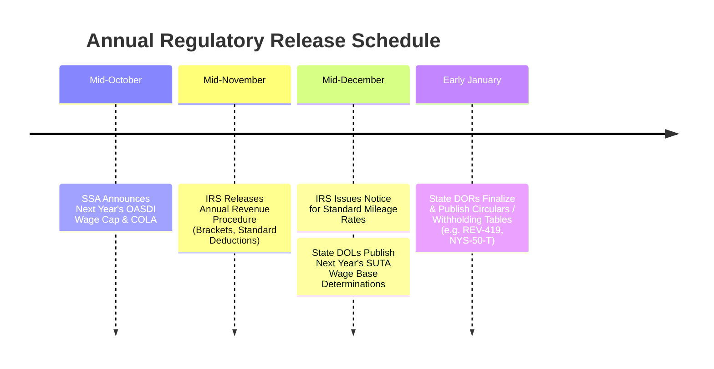

# Official Regulatory Sources Directory (Federal & 50 States)

This directory catalogues the authoritative government repositories, publications, and locator patterns for Federal and all 50 U.S. states (+ DC) for tax years **2025**, **2026**, and **future tax years (2027+)**.

Governed by the core dogma: **"Tax law is data, not application code."** All citations in TaxShield Ledger packages must reference authoritative Tier-1 government sources.

---

## 1. Federal Regulatory Authorities (IRS, SSA, USDOL)

| Tax Component | Governing Authority | 2025 Official Source | 2026 Official Source | Future Years (2027+) Locator Pattern |
| :--- | :--- | :--- | :--- | :--- |
| **Federal Withholding (FIT)** | Internal Revenue Service (IRS) | [IRS Pub 15-T (2025)](https://www.irs.gov/pub/irs-prior/p15t--2025.pdf) | [IRS Pub 15-T (2026)](https://www.irs.gov/pub/irs-pdf/p15t.pdf) | `https://www.irs.gov/pub/irs-prior/p15t--YYYY.pdf` or current `/p15t.pdf` |
| **FICA Social Security (OASDI)** | Social Security Administration | [SSA 2025 Fact Sheet (\$176,100)](https://www.ssa.gov/news/press/factsheets/colafacts2025.pdf) | [SSA 2026 Fact Sheet (\$181,800)](https://www.ssa.gov/news/press/factsheets/colafacts2026.pdf) | `https://www.ssa.gov/news/press/factsheets/colafactsYYYY.pdf` (Released mid-October) |
| **FICA Medicare (HI)** | Internal Revenue Service (IRS) | 26 U.S.C. § 3101(b) / [Pub 15 (2025)](https://www.irs.gov/pub/irs-prior/p15--2025.pdf) | 26 U.S.C. § 3101(b) / [Pub 15 (2026)](https://www.irs.gov/pub/irs-pdf/p15.pdf) | Uncapped 1.45% employee / 1.45% employer; 0.9% Additional Medicare over \$200,000 |
| **Standard Mileage Rate** | Internal Revenue Service (IRS) | [IRS Notice 2025-05 (70.0¢/mi)](https://www.irs.gov/newsroom/irs-issues-standard-mileage-rates-for-2025) | [IRS Notice 2026-XX (70.5¢/mi)](https://www.irs.gov/newsroom/irs-issues-standard-mileage-rates-for-2026) | `https://www.irs.gov/tax-professionals/standard-mileage-rates` (Released mid-December) |
| **Federal Unemployment (FUTA)** | U.S. Department of Labor / IRS | 26 U.S.C. § 3301 / [Pub 15](https://www.irs.gov/pub/irs-pdf/p15.pdf) | 26 U.S.C. § 3301 / [Pub 15](https://www.irs.gov/pub/irs-pdf/p15.pdf) | Statutory 6.0% with maximum 5.4% state credit $\to$ **0.60%** on first \$7,000 |

---

## 2. State Personal Income Tax Architecture Breakdown

To streamline package authoring, all 50 states and the District of Columbia fall into three distinct architectural categories:

1. **No Personal Income Tax on Wages (9 States)**:
   - `AK`, `FL`, `NV`, `NH` (dividends/interest phased out), `SD`, `TN`, `TX`, `WA` (capital gains excise only), `WY`.
   - Rule formulation: Flat rate `0.00%` with constitutional/statutory citation + SUTA employer rule.
2. **Flat Tax Rate States (14 States)**:
   - `AZ` (2.5%), `CO` (4.4%), `GA` (5.39%), `ID` (5.695%), `IL` (4.95%), `IN` (3.0% / 2026: 2.95%), `IA` (3.8%), `KY` (4.0%), `MI` (4.25%), `MS` (4.7% / 2026: 4.0%), `NC` (4.5% / 2026: 3.99%), `PA` (3.07%), `UT` (4.55%), `DC` (has progressive tiers).
   - Rule formulation: `FLAT_RATE` with state statutory code.
3. **Progressive / Graduated Bracket States (28 States + DC)**:
   - `AL`, `AR`, `CA`, `CT`, `DE`, `HI`, `KS`, `LA`, `ME`, `MD`, `MA` (flat + surtax), `MN`, `MO`, `MT`, `NE`, `NJ`, `NM`, `NY`, `ND`, `OH`, `OK`, `OR`, `RI`, `SC`, `VT`, `VA`, `WV`, `WI`.
   - Rule formulation: `BRACKET_PERCENTAGE` with contiguous boundary tiers (`incomeTo === next.incomeFrom`).

---

## 3. Authoritative Directory: All 50 States + DC

| St | Department of Revenue / Tax Agency (PIT Withholding) | Department of Labor / Workforce (SUTA Wage Base) | Tax Type |
| :--- | :--- | :--- | :--- |
| **AL** | [Alabama Dept. of Revenue](https://revenue.alabama.gov/individual-corporate/withholding-tax/) | [Alabama Dept. of Labor](https://labor.alabama.gov/uc/tax/) | Progressive (2% - 5%) |
| **AK** | [Alaska Dept. of Revenue](https://dor.alaska.gov/) | [Alaska Dept. of Labor & Workforce](https://labor.alaska.gov/estax/) | **No State Wage PIT** |
| **AZ** | [Arizona Dept. of Revenue](https://azdor.gov/withholding-tax) | [Arizona Dept. of Economic Security](https://des.az.gov/services/employment/unemployment-employer) | Flat Rate (2.50%) |
| **AR** | [Arkansas Dept. of Finance & Admin](https://www.dfa.arkansas.gov/excise-tax/income-tax/withholding-tax/) | [Arkansas Division of Workforce Services](https://dws.arkansas.gov/employers/) | Progressive (2% - 3.9%) |
| **CA** | [California Franchise Tax Board](https://www.ftb.ca.gov/) / [EDD DE 44](https://edd.ca.gov/en/payroll_taxes/forms_and_publications/) | [California EDD (Unemployment)](https://edd.ca.gov/en/payroll_taxes/rates_and_withholding/) | Progressive (1% - 13.3%) |
| **CO** | [Colorado Dept. of Revenue](https://tax.colorado.gov/withholding-tax) | [Colorado Dept. of Labor & Employment](https://cdle.colorado.gov/employers/premiums) | Flat Rate (4.40%) |
| **CT** | [Connecticut Dept. of Revenue Services](https://portal.ct.gov/drs/withholding-taxes/withholding-tax-information) | [Connecticut Dept. of Labor](https://ctdol.state.ct.us/uitax/) | Progressive (2% - 6.99%) |
| **DE** | [Delaware Division of Revenue](https://revenue.delaware.gov/withholding-tax/) | [Delaware Dept. of Labor](https://labor.delaware.gov/divisions/unemployment-insurance/) | Progressive (0% - 6.6%) |
| **DC** | [DC Office of Tax and Revenue](https://otr.cfo.dc.gov/page/withholding-tax) | [DC Dept. of Employment Services](https://does.dc.gov/service/unemployment-compensation-employers) | Progressive (4% - 10.75%) |
| **FL** | [Florida Dept. of Revenue](https://floridarevenue.com/taxes/taxesfees/Pages/reemployment.aspx) | [Florida Commerce / Reemployment](https://floridarevenue.com/taxes/taxesfees/Pages/reemployment.aspx) | **No State Wage PIT** |
| **GA** | [Georgia Dept. of Revenue](https://dor.georgia.gov/taxes/withholding-tax) | [Georgia Dept. of Labor](https://dol.georgia.gov/employers/unemployment-tax) | Flat Rate (5.39%) |
| **HI** | [Hawaii Dept. of Taxation](https://tax.hawaii.gov/forms/a1_b2_1withhold/) | [Hawaii DLIR Unemployment](https://labor.hawaii.gov/ui/) | Progressive (1.4% - 11%) |
| **ID** | [Idaho State Tax Commission](https://tax.idaho.gov/taxes/withholding/) | [Idaho Dept. of Labor](https://www.labor.idaho.gov/businesses/unemployment-tax/) | Flat Rate (5.695%) |
| **IL** | [Illinois Dept. of Revenue (Booklet IL-700-T)](https://tax.illinois.gov/research/taxrates/withholding.html) | [Illinois Dept. of Employment Security](https://ides.illinois.gov/employers.html) | Flat Rate (4.95%) |
| **IN** | [Indiana Dept. of Revenue (Notice #1)](https://www.in.gov/dor/business-tax/withholding-income-tax/) | [Indiana Dept. of Workforce Development](https://www.in.gov/dwd/indiana-unemployment/employers/) | Flat Rate (3.0% / 2.95%) |
| **IA** | [Iowa Dept. of Revenue](https://tax.iowa.gov/withholding-tax-information) | [Iowa Workforce Development](https://www.iowaworkforcedevelopment.gov/my-unemployment-insurance) | Flat Rate (3.80%) |
| **KS** | [Kansas Dept. of Revenue (KW-100)](https://www.ksrevenue.gov/eservwh.html) | [Kansas Dept. of Labor](https://www.kansasdol.gov/employers) | Progressive (3.1% - 5.7%) |
| **KY** | [Kentucky Dept. of Revenue](https://revenue.ky.gov/Business/Withholding-Tax/Pages/default.aspx) | [Kentucky Education & Labor Cabinet](https://kcc.ky.gov/career/Pages/Employer-Services.aspx) | Flat Rate (4.00%) |
| **LA** | [Louisiana Dept. of Revenue](https://revenue.louisiana.gov/WithholdingTax) | [Louisiana Workforce Commission](https://www.laworks.net/Unemployment/UI_Claimants.asp) | Progressive (1.85% - 4.25%) |
| **ME** | [Maine Revenue Services](https://www.maine.gov/revenue/taxes/withholding-pass-through-entity) | [Maine Dept. of Labor](https://www.maine.gov/labor/unemployment/) | Progressive (5.8% - 7.15%) |
| **MD** | [Comptroller of Maryland (MW506)](https://www.marylandtaxes.gov/business/withholding/index.php) | [Maryland Dept. of Labor](https://www.labor.maryland.gov/employment/uitaxtables.shtml) | Progressive (2% - 5.75%) |
| **MA** | [Massachusetts Dept. of Revenue (Circular M)](https://www.mass.gov/info-details/massachusetts-withholding-taxes) | [Massachusetts DUA](https://www.mass.gov/orgs/department-of-unemployment-assistance) | Flat Rate (5.00% + Surtax) |
| **MI** | [Michigan Dept. of Treasury](https://www.michigan.gov/taxes/business-taxes/withholding) | [Michigan Unemployment Insurance Agency](https://www.michigan.gov/leo/bureaus-agencies/uia) | Flat Rate (4.25%) |
| **MN** | [Minnesota Dept. of Revenue](https://www.revenue.state.mn.us/withholding-tax) | [Minnesota Unemployment Insurance](https://www.uimn.org/employers/) | Progressive (5.35% - 9.85%) |
| **MS** | [Mississippi Dept. of Revenue](https://www.dor.ms.gov/business/withholding-tax) | [Mississippi Dept. of Employment Security](https://mdes.ms.gov/employers/unemployment-tax/) | Flat Rate (4.7% / 4.0%) |
| **MO** | [Missouri Dept. of Revenue](https://dor.mo.gov/taxation/business/tax-types/withholding/) | [Missouri Division of Employment Security](https://labor.mo.gov/des/employers) | Progressive (2% - 4.8%) |
| **MT** | [Montana Dept. of Revenue](https://mtrevenue.gov/taxes/withholding-tax/) | [Montana Dept. of Labor & Industry](https://dli.mt.gov/employers) | Progressive (4.7% - 5.9%) |
| **NE** | [Nebraska Dept. of Revenue (Circular EN)](https://revenue.nebraska.gov/businesses/withholding-tax) | [Nebraska Dept. of Labor](https://dol.nebraska.gov/UIBenefits) | Progressive (2.46% - 5.84%) |
| **NV** | [Nevada Dept. of Taxation](https://tax.nv.gov/) | [Nevada DETR](https://detr.nv.gov/Page/Unemployment_Insurance_for_Employers) | **No State Wage PIT** |
| **NH** | [New Hampshire Dept. of Revenue](https://www.revenue.nh.gov/) | [New Hampshire Employment Security](https://www.nhes.nh.gov/employers/index.htm) | **No State Wage PIT** |
| **NJ** | [New Jersey Division of Taxation (NJ-WT)](https://www.nj.gov/treasury/taxation/withholding/index.shtml) | [New Jersey Dept. of Labor](https://www.nj.gov/labor/ea/ea_index.html) | Progressive (1.4% - 10.75%) |
| **NM** | [New Mexico Taxation & Revenue](https://www.tax.newmexico.gov/businesses/wage-withholding-overview/) | [New Mexico Dept. of Workforce Solutions](https://www.dws.state.nm.us/en-us/Employers) | Progressive (1.5% - 5.9%) |
| **NY** | [New York Dept. of Taxation & Finance (NYS-50-T)](https://www.tax.ny.gov/bus/wt/nys50_t.htm) | [New York Dept. of Labor](https://dol.ny.gov/unemployment-insurance-employers) | Progressive (4% - 10.9%) |
| **NC** | [North Carolina Dept. of Revenue (NC-30)](https://www.ncdor.gov/taxes/withholding-tax) | [North Carolina DES](https://des.nc.gov/employers) | Flat Rate (4.5% / 3.99%) |
| **ND** | [North Dakota State Tax Commissioner](https://www.tax.nd.gov/tax-types/withholding-tax) | [Job Service North Dakota](https://www.jobsnd.com/unemployment-employers) | Progressive (1.1% - 2.9%) |
| **OH** | [Ohio Dept. of Taxation](https://tax.ohio.gov/business/ohio-business-taxes/employer-withholding) | [Ohio Dept. of Job & Family Services](https://jfs.ohio.gov/job-services-and-unemployment) | Progressive (2.75% - 3.5%) |
| **OK** | [Oklahoma Tax Commission](https://oklahoma.gov/tax/businesses/withholding-tax.html) | [Oklahoma Employment Security Commission](https://oklahoma.gov/oesc/employers.html) | Progressive (0.25% - 4.75%) |
| **OR** | [Oregon Dept. of Revenue](https://www.oregon.gov/dor/programs/businesses/Pages/payroll.aspx) | [Oregon Employment Dept.](https://www.oregon.gov/employ/businesses/taxes/pages/default.aspx) | Progressive (4.75% - 9.9%) |
| **PA** | [Pennsylvania Dept. of Revenue (REV-419)](https://www.revenue.pa.gov/FormsandPublications/FormsforBusinesses/EmployerWithholding/Documents/rev-419.pdf) | [Pennsylvania Dept. of Labor & Industry (UC-2)](https://www.uc.pa.gov/employers-uc-services-taxes/Pages/default.aspx) | Flat Rate (3.07%) |
| **RI** | [Rhode Island Division of Taxation](https://tax.ri.gov/tax-sections/withholding-tax) | [Rhode Island Dept. of Labor & Training](https://dlt.ri.gov/employers/unemployment-insurance) | Progressive (3.75% - 5.99%) |
| **SC** | [South Carolina Dept. of Revenue](https://dor.sc.gov/tax/withholding) | [South Carolina DEW](https://dew.sc.gov/employers/unemployment-insurance-taxes) | Progressive (0% - 6.2%) |
| **SD** | [South Dakota Dept. of Revenue](https://dor.sd.gov/) | [South Dakota Dept. of Labor & Regulation](https://dlr.sd.gov/ra/employers.aspx) | **No State Wage PIT** |
| **TN** | [Tennessee Dept. of Revenue](https://www.tn.gov/revenue.html) | [Tennessee Dept. of Labor & Workforce](https://www.tn.gov/workforce/employers.html) | **No State Wage PIT** |
| **TX** | [Texas Comptroller of Public Accounts](https://comptroller.texas.gov/) | [Texas Workforce Commission](https://www.twc.texas.gov/businesses/unemployment-tax) | **No State Wage PIT** |
| **UT** | [Utah State Tax Commission (Pub 14)](https://tax.utah.gov/withholding) | [Utah Dept. of Workforce Services](https://jobs.utah.gov/ui/employer/) | Flat Rate (4.55%) |
| **VT** | [Vermont Dept. of Taxes](https://tax.vermont.gov/business/withholding) | [Vermont Dept. of Labor](https://labor.vermont.gov/unemployment-insurance/employers) | Progressive (3.35% - 8.75%) |
| **VA** | [Virginia Dept. of Taxation](https://www.tax.virginia.gov/withholding-tax) | [Virginia Employment Commission](https://www.vec.virginia.gov/employers) | Progressive (2% - 5.75%) |
| **WA** | [Washington Dept. of Revenue](https://dor.wa.gov/) | [Washington Employment Security Dept.](https://esd.wa.gov/employer-taxes) | **No State Wage PIT** |
| **WV** | [West Virginia State Tax Dept.](https://tax.wv.gov/Business/WithholdingTax/Pages/WithholdingTax.aspx) | [WorkForce West Virginia](https://workforcewv.org/employers/) | Progressive (2.36% - 5.12%) |
| **WI** | [Wisconsin Dept. of Revenue (Pub W-166)](https://www.revenue.wi.gov/Pages/HTML/withholding.aspx) | [Wisconsin Dept. of Workforce Development](https://dwd.wisconsin.gov/uitax/) | Progressive (3.5% - 7.65%) |
| **WY** | [Wyoming Dept. of Revenue](https://revenue.wyo.gov/) | [Wyoming Dept. of Workforce Services](https://dws.wyo.gov/dws-division/unemployment-insurance/) | **No State Wage PIT** |

---

## 4. Annual Rollover Playbook (Discovering 2025, 2026, and 2027+)

Follow this timeline and procedure to locate authoritative documents for any new tax year:



### URL Resolution Patterns for Future Years

1. **IRS Circulars & Publications**:
   - Active/current year: `https://www.irs.gov/pub/irs-pdf/p<NUMBER>.pdf` (e.g. `p15.pdf`, `p15t.pdf`).
   - Prior year archive: `https://www.irs.gov/pub/irs-prior/p<NUMBER>--<YEAR>.pdf` (e.g. `p15--2025.pdf`, `p15t--2025.pdf`).
2. **State DOR Withholding Bulletins**:
   - Most state agencies maintain a stable file naming pattern parameterized by tax year:
     - Pennsylvania: `https://www.revenue.pa.gov/.../rev-419-<YEAR>.pdf`
     - New York: `https://www.tax.ny.gov/pdf/publications/withholding/nys50_t_<YEAR>.pdf`
     - California: `https://edd.ca.gov/siteassets/files/pdf_pub_ctr/de44.pdf`

---

## 5. Capturing Checksums for Package Ingestion

When downloading or referencing an authoritative PDF/bulletin, generate its SHA-256 document hash to ensure citation tamper resistance:

```bash
# Windows PowerShell
Get-FileHash ./rev-419-2025.pdf -Algorithm SHA256 | Select-Object -ExpandProperty Hash

# Linux / macOS
sha256sum ./rev-419-2025.pdf | awk '{print "sha256:" $1}'
```

Once obtained, populate the `documentHash` property in your authority adapter or draft JSON file, then run:

```bash
pnpm cli ingest <AUTHORITY> <TAX_YEAR> ./packages/<STATE>-<YEAR>-draft.json
```
